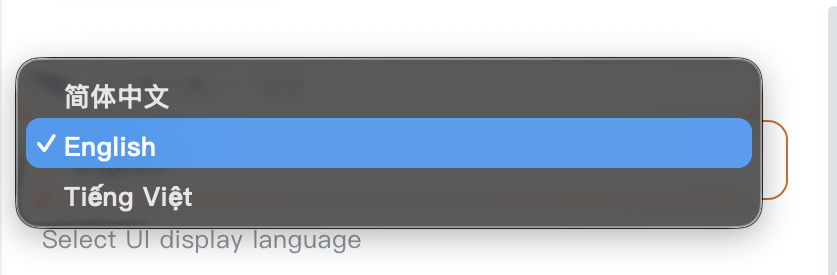

# Reader

[](https://github.com/kikyo2006/reader/releases)
[](https://github.com/kikyo2006/reader/actions/workflows/release.yml)
[](LICENSE)

> A modern local desktop reading client: manage your own book sources and bookshelf, read local files, subscribe to RSS feeds, and customize your reading experience just the way you like.

Reader is a cross-platform desktop port inspired by "Legado" ([阅读 3.0](https://github.com/Rimchars/legado)), supporting Windows, macOS, and Linux. Built with Rust, Tauri v2, and Vue 3.

Designed with a local-first philosophy, it requires no backend servers, database containers, or user account registrations. The UI and local core run inside the same desktop process, leaving your bookshelf, reading progress, caches, and preferences entirely under your ownership.

Originated from [reader](https://github.com/hectorqin/reader) and refactored with reference to [reader-rust](https://github.com/givenge/reader-rust).

> [!IMPORTANT]
> This software does not bundle any book sources or host copyrighted literary content. Upon first launch, you can import your own legally authorized book sources or local TXT, EPUB, and PDF files.

## UI Preview

### Bookshelf & Reading

<p align="center"></p>
<p align="center"></p>

### Book Sources & Explore

<p align="center">
  
  
</p>

### Statistics & RSS

<p align="center">
  
  
</p>

### Multi-Language Support

<p align="center"></p>

Reader provides comprehensive localization out-of-the-box for:
- **English** (`en-US`)
- **Tiếng Việt** (`vi-VN`)
- **简体中文** (`zh-CN`)

Switch display languages on-the-fly anytime in **Settings → Language** (`Cài đặt → Ngôn ngữ` / `设置 → 界面语言`) without needing to restart the application.

---

## Highlights

- **Local-First**: Zero reliance on cloud servers or external accounts; data stays securely on your machine.
- **Legado Ecosystem Compatibility**: Seamlessly import, parse, and restore Legado book sources, RSS feeds, and backup archives.
- **Multi-Language Support**: Fully localized interface in English, Vietnamese, and Simplified Chinese with instant switching.
- **Complete Source DevTools**: Import, edit, test, and debug book sources and login sessions directly within the desktop UI.
- **Highly Customizable Reader**: Tailor typography, themes, fonts, paging animations, window transparency, and background images.
- **Diverse TTS Engines**: Listen to books using system speech voices or cloud-based API speech providers (OpenAI, Fish Audio, ElevenLabs, Azure, Edge).
- **Cross-Platform**: Automated CI builds for Windows, macOS, and Linux with both installers and portable binaries.

## Features

### Book Sources, Search & Caching

- Import, export, create, edit, and batch-test JSON book sources.
- Multi-source batch operations and non-blocking cancelable testing.
- Remote source subscription with one-click synchronization.
- Flexible parsing rules: CSS Selectors, JSONPath, XPath, Regular Expressions, and JavaScript.
- Concurrent multi-source search with automatic title/author merging and deduplication.
- Chapter caching, background preloading, and offline reading.
- Visual rule editor with raw response inspection and step-by-step rule debugger.
- Built-in source login dialog supporting web views, custom credential forms, and Cookie management.

### Reading Experience

- Grouped bookshelf, recent reading records, bookmarks, and auto-synced reading position.
- Support for local TXT, EPUB, PDF files as well as remote web novels.
- Day, night, and custom color themes matching system dark/light modes.
- Rich typography settings: font family, font size, font weight, line height, paragraph spacing, text indent, and page width.
- Multiple reading modes: single chapter scroll, horizontal paging, continuous reading, auto-scroll, and click-to-flip.
- Simplified/Traditional Chinese conversion, text selection toolbar, content filtering, and custom regex replacement rules.
- Context menu for quick search, bookmarking, source switching, and instant content refresh.
- Custom background images and per-window opacity adjustments (Windows, 10%–100%).
- Mini Mode: Collapse into a compact, always-on-top floating reader window for discreet reading.

### Multi-Language Localization

- Complete UI translation for **English**, **Vietnamese** (`Tiếng Việt`), and **Simplified Chinese** (`简体中文`).
- Instant runtime switching with immediate reactive UI re-render and persistent storage.
- Auto-localized date formats, reading statistics units, and default section labels.

### Reading Statistics & RSS Feeds

- Track total reading time, read character counts, and active consecutive streak days.
- Interactive charts showing daily reading trends and per-book reading time breakdown.
- Full RSS feed reader: subscribe to feeds, parse articles, and view embedded web content.
- RSS articles and standard books unified within the recent history panel.

### Data Management & Backup

- Local backup and restore with full ZIP and legacy JSON archive support.
- Bi-directional WebDAV synchronization compatible with Legado mobile app (`bookProgress` directory).
- Safe restore mechanism: invalid or corrupt items are gracefully skipped with warnings rather than aborting.
- System tray minimization and configurable global Boss Key (anti-boss panic hotkey).
- Multi-monitor awareness: window position and size auto-adjust if an external display is disconnected.

### Web Access (Mobile Reading)

- Read your desktop bookshelf from your mobile phone or tablet browser via the embedded web server (**Settings → App → Web Access**).
- Listens on `127.0.0.1:1122` by default; enable LAN access to read from any device on your local Wi-Fi.
- Read bookshelf, table of contents, chapters, and bookmarks with Wi-Fi file upload support.

See [`docs/web-reader.md`](docs/web-reader.md) for full details.

## Quick Start

1. Download the latest installer or portable archive for your OS from [Releases](https://github.com/kikyo2006/reader/releases).
2. Launch the app and import your book sources or local TXT, EPUB, or PDF files.
3. Search for titles from the top search bar, add them to your shelf, and start reading.
4. Adjust themes and backgrounds in General Settings, or fine-tune typography and TTS in Reader Settings.
5. Switch to Mini Mode via the title bar button for compact reading, or configure a Boss Key for instant privacy.

## Downloads & Supported Platforms

Automated release builds support the following targets:

| OS | Architecture | Installer | Portable Package |
| --- | --- | --- | --- |
| Windows | x64 | NSIS (`.exe`) | ZIP (`.zip`) |
| macOS | Intel + Apple Silicon | DMG (`.dmg`) | Universal APP (`.zip`) |
| Linux | x64 | DEB (`.deb`) | AppImage (`.AppImage`) |

*Note for macOS users:* macOS packages are not signed with an Apple Developer certificate. On first launch, macOS Gatekeeper may show a warning; right-click the app and choose "Open", or allow it in System Settings → Privacy & Security.

Windows portable builds run directly from `Reader.exe` and store all user data in a portable `data/` directory alongside the executable.

On macOS, data is stored at `~/Library/Application Support/reader/data` to ensure persistence across application updates.

## TTS (Text-to-Speech) Setup

Open **Reader Settings → Speech** in the reading view to configure reading voices:

- **System Speech**: Uses the operating system's built-in voice synthesizers with speed, pitch, and timer controls.
- **API Speech**: Sends requests directly to cloud-based speech providers supporting OpenAI, Fish Audio, ElevenLabs, and Azure compatible formats.

| API Format | Service Base URL Example | Model / Language Code | Voice Identifier |
| --- | --- | --- | --- |
| OpenAI Compatible | `https://api.openai.com` | TTS Model name (e.g., `tts-1`) | Voice Name |
| Fish Audio Compatible | `https://api.fish.audio` | TTS Model name | Voice ID |
| ElevenLabs Compatible | `https://api.elevenlabs.io` | TTS Model name | Voice ID |
| Azure Compatible | Azure Speech Resource Endpoint | Language code (e.g., `zh-CN`, `en-US`, `vi-VN`) | Voice Name |

HTTP proxies can be configured specifically for TTS requests if cloud providers require proxy routing.

> [!WARNING]
> API access tokens are stored in your local configuration. If you export your reading configuration, make sure not to publicly share backups containing confidential API keys.

## Backup & Restore

Manage your backups under **Settings → Data → Backup & Restore**:

- Backups are compressed into standardized ZIP archives (fully compatible with Legado).
- Built-in WebDAV client allows manual upload, download, and synchronization with cloud storage providers (Nextcloud, TeraCloud, InfiniCLOUD, etc.).
- Reading progress syncs automatically with Legado's `bookProgress` format upon opening or closing books.

## Data & Privacy

- No centralized accounts or tracking: your books, configurations, notes, and history remain strictly on your local disk.
- Network requests for book search and content fetching automatically respect system proxies when available.
- TTS requests are only sent to the specific API provider configured by the user.
- Reader does not distribute or endorse third-party book sources; users should verify the legitimacy and safety of their imported sources.

## Development & Build

Prerequisites: Node.js 22, Rust stable, and system dependencies required by Tauri v2.

```bash
# Frontend
cd frontend
npm install
npm run dev
npm run build
npm test

# Desktop App
cd desktop
npm install
npm run dev
npm run build
```

Running unit tests:

```bash
# Rust core tests
cargo test -j 4

# Frontend tests
cd frontend && npm test
```

## Architecture

- **Desktop Shell**: Tauri v2, native webview wrapper.
- **Frontend**: Vue 3, Vite, TypeScript, Pinia, Vue Router, ECharts.
- **Core Engine**: Rust, Tokio, Reqwest, SQLx, SQLite, rquickjs.
- **IPC Protocol**: Strongly typed Tauri commands and custom application protocols for streaming EPUB assets and media.
- **Local Storage**: Embedded SQLite database for relational metadata; local filesystem for book covers, cached chapters, and backups.

Directory layout:

| Path | Description |
| --- | --- |
| `frontend/` | Vue 3 UI, Pinia stores, i18n locales, and unit tests |
| `src/api/` | Tauri command handlers, custom protocols, and desktop IPC |
| `src/server/` | Web access engine: axum routes, static server, and configuration |
| `src/app/` | Application lifecycle, bootstrap, and window persistence |
| `src/service/` | Business logic for books, sources, RSS, TTS, and updates |
| `src/parser/` | CSS, XPath, JSONPath, Regex, and JavaScript rule parsers |
| `src/crawler/` | HTTP client, rate limiters, header extractors, and networking |
| `src/storage/` | SQLite database migrations, cache storage, and data paths |
| `desktop/src-tauri/` | Desktop windowing, tray menus, single-instance lock, and packaging |
| `scripts/` | Release scripts, validation tools, and build helpers |

## Contributing

- To report bugs or request features, please open an issue on [GitHub Issues](https://github.com/kikyo2006/reader/issues).
- Pull requests are welcome! Please ensure frontend tests, build steps, and Rust tests pass before submitting.
- Never commit private tokens, confidential cookies, or copyrighted book contents.

## Disclaimer

This project is an open-source technical tool providing book source parsing, caching, and reading features. It does not contain, host, distribute, or provide copyrighted literature. Users are solely responsible for ensuring their book sources and local files comply with applicable copyright laws in their jurisdiction.

If you are a copyright owner and believe any aspect of this open-source tool infringes upon your rights, please contact the maintainers via GitHub Issues.

## License

This project is licensed under the [MIT License](LICENSE).

## Acknowledgements

Special thanks to [Legado](https://github.com/Rimchars/legado), [reader](https://github.com/hectorqin/reader), and [reader-rust](https://github.com/givenge/reader-rust) for providing the foundational concepts and reference implementations.

Special thanks: [LinuxDO](https://linux.do/).
